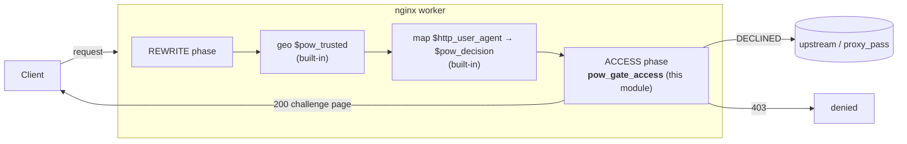
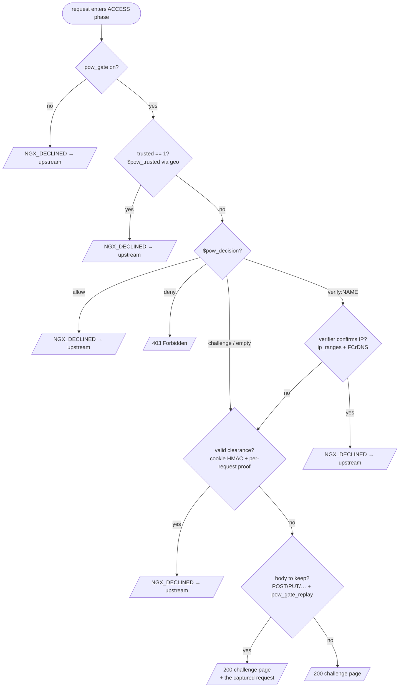
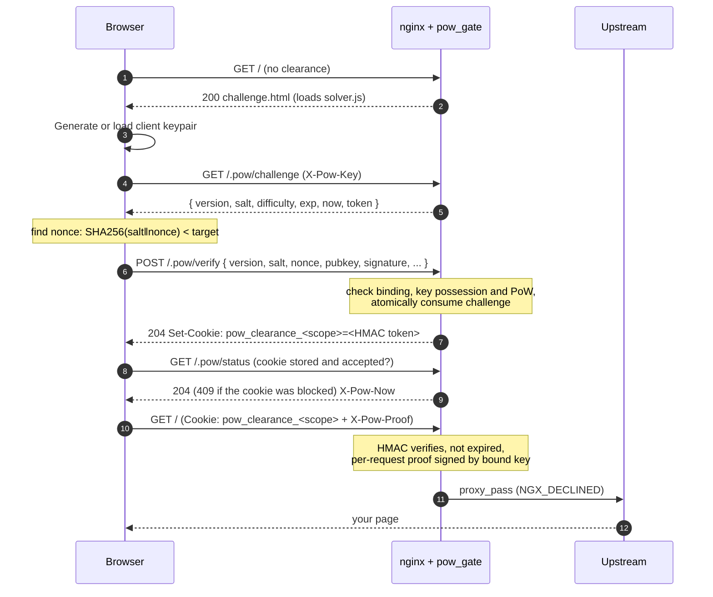

# ngx_http_pow_gate_module

[](https://github.com/teian/ngx_http_pow_gate/actions/workflows/ci.yml)
[](https://github.com/teian/ngx_http_pow_gate/actions/workflows/module-amd64.yml)
[](https://github.com/teian/ngx_http_pow_gate/actions/workflows/module-arm64.yml)

> **Protocol v2 (since 0.5.0):** challenges commit the client key and address/UA/policy
> context, require key possession and redeem once across nginx workers. Clearances
> use the same binding and enforce minimum difficulty. The default replay store
> uses **2 MiB shared per nginx instance**, survives graceful reloads and fails
> closed at capacity. Its full restarts invalidate tokens. Optional [Redis
> coordination](docs/redis.md) supports multiple instances and survives restarts. V1 cookies/clients are not
> accepted. See [security](docs/security.md).
>
> Builds, CI and [releases](https://github.com/teian/ngx_http_pow_gate/releases)
> always cover the latest pinned **mainline 1.31.10 and stable 1.30.7**,
> each on glibc/musl and amd64/arm64. Signed, reproducible modules are published
> per release — see [Installing a released module](#installing-a-released-module).
> To build a channel yourself:
> `./scripts/build-nginx.sh stable --target nginx-smoke-debian`.

A native **nginx dynamic module** that puts a **proof-of-work (PoW) gate** in front
of your sites to deter scrapers, AI crawlers, and abusive bots — while letting
real browsers, trusted networks, and *verified* good bots through with no friction.

It is written in Rust against [`ngx`](https://github.com/nginxinc/ngx-rust) (the
official nginx-rust bindings) and plugs into nginx's **ACCESS phase**. Crucially,
it does **not** reinvent matching: trusted networks come from the built-in `geo`
module, and per–User-Agent decisions come from the built-in `map` module. The
module only adds what stock nginx can't do: issuing/verifying proof-of-work,
clearance cookies, and a *verified good-bot* allowlist (official IP ranges + FCrDNS).

> **Status:** functional end to end, including the browser solver, good-bot
> verifier, request replay, outcome logging and optional Redis coordination.
> See [testing](docs/testing.md) for the tested versions, local review results
> and CI matrix, and the [release notes](docs/releases/) for what changed.

---

## Table of contents

- [Why a PoW gate](#why-a-pow-gate)
- [How it works (at a glance)](#how-it-works-at-a-glance)
- [Request decision flow](#request-decision-flow)
- [The challenge / solve / verify handshake](#the-challenge--solve--verify-handshake)
- [Quickstart](#quickstart)
- [Configuration](#configuration)
- [Logging and diagnostics](#logging-and-diagnostics)
- [Running several gateways](#running-several-gateways)
- [Project layout](#project-layout)
- [Installing a released module](#installing-a-released-module)
- [Building](#building)
- [Performance](#performance)
- [What's implemented](#whats-implemented)
- [Documentation](#documentation)

---

## Why a PoW gate

A proof-of-work gate makes every un-trusted client spend a small amount of CPU
**before** it reaches your upstream. For a human loading a page once, that's a
few hundred milliseconds, invisible behind a "Just a moment…" screen. For a
scraper acquiring many client clearances, that cost accumulates — without IP blocklists, CAPTCHAs, or a third-party service.

The gate is layered so most traffic never pays:

| Client                                   | Outcome                                |
| ---------------------------------------- | -------------------------------------- |
| Trusted network (your LAN, your LB)      | pass — `geo` match                     |
| Verified good bot (Googlebot, Bingbot…)  | pass — IP-range + FCrDNS check         |
| Known-abusive UA (GPTBot, Bytespider…)   | `403` — `map` → `deny`                 |
| Already-cleared browser (valid cookie)   | pass — clearance cookie + proof        |
| Everyone else                            | **challenge** — solve, then pass       |

The challenge itself comes in tiers, chosen per client by the same `map`
(see [docs/configuration.md › Decision values](docs/configuration.md#decision-values)):
`challenge:js` (prove JS execution, no measurable work), `challenge` /
`challenge:<N>` (proof-of-work at the configured or a per-decision difficulty,
solved multi-threaded across Web Workers), and `challenge:nojs[:secs]` (a
meta-refresh wait for text browsers like lynx/w3m — no JavaScript required).

---

## How it works (at a glance)



The module reads the results of the native `geo`/`map` engines as the variables
`$pow_trusted` and `$pow_decision`, then makes the final call in the ACCESS phase.
`NGX_DECLINED` means "I have no objection" → nginx continues to your upstream.

---

## Request decision flow

This is the exact branch logic in [`src/access.rs`](src/ngx-http-pow-gate/src/access.rs) — first match wins:



A challenged `POST` would otherwise be lost: the gate answers the submit with
the challenge page, and the reload afterwards is a `GET`. So the module reads
the body and hands the request back inside that page, where the solver re-issues
it once the clearance is minted — no request payload is retained server-side. See
[`pow_gate_replay`](docs/configuration.md#pow_gate_replay-on--off).

---

## The challenge / solve / verify handshake

When a client is challenged, it gets an HTML page that loads the solver. The
solver talks to the internal routes the module owns under `pow_gate_endpoint`
(default `/.pow/`): `challenge`, `verify`, `status` and the content-hashed
`solver.js`. A fifth route, `pass`, redeems the no-JS tier.



Two tokens, two jobs:

- **Clearance cookie** (`pow_gate_clearance_ttl`, default 12h) — proves the client
  *did the work*. HMAC-signed with your server key; bound to a client keypair.
  Long-lived on purpose: a human solves once, then browses for the day without
  being re-challenged.
- **Per-request proof** (`pow_gate_proof_skew`, e.g. 5s; stamped with server time,
  so wrong device clocks do not break it) — a DPoP-style signature
  proving possession of the clearance key for a recent request. Address/UA
  binding restricts cookie transfer; the signature adds key possession on
  requests carrying a proof. Demanded only
  from requests that can carry a custom header — `fetch`/XHR, marked
  `Sec-Fetch-Dest: empty` — and only with `pow_gate_require_proof on` (default
  `off`: it needs your pages to sign proofs on their own `fetch`/XHR calls);
  navigations and tag subresources (scripts, images, styles, fonts) always pass
  on a valid context-bound cookie.

What keeps the handshake from failing or looping in the field:

- **One-use redemption.** A solved challenge (or no-JS grant) is consumed
  atomically across all workers — or across all gateways with
  [Redis](docs/redis.md) — so one solution mints one clearance.
- **Context binding.** Challenges and clearances are bound to the client
  address (`pow_gate_ipv4_prefix` / `pow_gate_ipv6_prefix`), the User-Agent, the
  `pow_gate_policy` name and the difficulty tier. An easy or no-JS clearance
  never satisfies a stronger location.
- **Server-anchored clock (0.6.0).** The solver takes its time from the
  challenge response (`now`) and `X-Pow-Now`, so a wrong device clock neither
  expires challenges early nor breaks proofs. The page shows a localized warning
  when the device clock is off by a minute or more.
- **Bounded retries.** The solver confirms the clearance on `status` before
  navigating. A blocked cookie stops after three attempts with a visible error
  instead of a reload loop. Challenge pages and protocol responses are
  `no-store`; only the content-hashed `solver.js` is cached (immutable).

See [docs/protocol.md](docs/protocol.md) for token formats and endpoint contracts,
[docs/security.md](docs/security.md) for guarantees and limits,
and [docs/architecture.md](docs/architecture.md) for the threat model.

---

## Quickstart

```nginx
load_module modules/ngx_http_pow_gate_module.so;

http {
    pow_gate_hmac_key_file /etc/pow/hmac.key;   # the one server secret
    pow_gate_difficulty    50000;               # ~expected hashes per solve

    geo $pow_trusted {                          # built-in nginx module
        default        0;
        10.0.0.0/8     1;
    }

    map $http_user_agent $pow_decision {        # built-in nginx module
        default                       challenge;
        ~*(gptbot|ccbot|bytespider)   deny;
        ~*(googlebot|bingbot)         verify:search_engines;
    }

    server {
        location / {
            pow_gate          on;
            pow_gate_trusted  $pow_trusted;
            pow_gate_decision $pow_decision;
            proxy_pass http://backend;
        }

        # exclusions are just locations with the gate off — no new syntax
        location = /robots.txt { pow_gate off; proxy_pass http://backend; }
    }
}
```

A complete, commented example — including a `pow_gate_verifier` block and path
exclusions — is in [examples/nginx.conf](examples/nginx.conf).

---

## Configuration

Every directive at a glance. Full reference (contexts, defaults, edge cases) in
[docs/configuration.md](docs/configuration.md).

| Directive                  | Context              | Arg            | Purpose                                            |
| -------------------------- | -------------------- | -------------- | -------------------------------------------------- |
| `pow_gate`                 | http, server, location    | `on`\|`off`    | Enable/disable the gate (inheritable flag)         |
| `pow_gate_trusted`         | server, location          | `$var`         | Non-`0` ⇒ allow, skip the gate (usually `geo`)     |
| `pow_gate_decision`        | server, location          | `$var`         | `allow`\|`deny`\|`challenge[:tier]`\|`verify:<name>` |
| `pow_gate_page`            | http, server, location    | `<file>`       | Custom challenge page (templated; default embedded) |
| `pow_gate_nojs_page`       | http, server, location    | `<file>`       | Custom page for the `challenge:nojs` tier (default embedded) |
| `pow_gate_policy`          | http, server, location    | `<name>`       | Named clearance scope (default `default`); rename to invalidate its clearances |
| `pow_gate_ipv4_prefix`     | http, server, location    | `1..32`        | IPv4 prefix a clearance is bound to (default `32`) |
| `pow_gate_ipv6_prefix`     | http, server, location    | `1..128`       | IPv6 prefix a clearance is bound to (default `128`; `64` tolerates privacy addresses) |
| `pow_gate_difficulty`      | http, server, location    | `N`            | Expected hash count per solve (default `50000`)    |
| `pow_gate_hmac_key_file`   | http, server, location    | `<file>`       | Server secret for clearance/proof signing          |
| `pow_gate_clearance_ttl`   | http, server, location    | `<time>`       | How long a clearance lasts (default `12h`)         |
| `pow_gate_proof_skew`      | http, server, location    | `<time>`       | Per-request proof validity window (default `5s`)   |
| `pow_gate_require_proof`   | http, server, location    | `on`\|`off`    | Demand `X-Pow-Proof` on fetch/XHR (default `off`)  |
| `pow_gate_endpoint`        | http, server, location    | `<prefix>`     | Internal route prefix (default `/.pow/`)           |
| `pow_gate_replay`          | http, server, location    | `on`\|`off`    | Keep a challenged `POST` (any data-carrying method) alive across the challenge (default `on`) |
| `pow_gate_replay_max_body` | http, server, location    | `<size>`       | Largest body captured for that replay (default `1m`, matching `client_max_body_size`) |
| `pow_gate_cookie_name`     | http, server, location    | `<name>`       | Clearance cookie base name (default `pow_clearance`) |
| `pow_gate_cookie_scope_suffix` | http, server, location | `on`\|`off`   | Append a scope-derived suffix to the cookie name (default `on`) |
| `pow_gate_cookie_domain`   | http, server, location    | `<domain>`     | Cookie `Domain=` (default host-only)               |
| `pow_gate_cookie_path`     | http, server, location    | `<path>`       | Cookie `Path=` (default `/`)                       |
| `pow_gate_cookie_samesite` | http, server, location    | `Lax\|Strict\|None` | Cookie `SameSite=` (default `Lax`)            |
| `pow_gate_cookie_secure`   | http, server, location    | `on`\|`off`    | Cookie `Secure` flag (default `on`)                |
| `pow_gate_cookie_httponly` | http, server, location    | `on`\|`off`    | Cookie `HttpOnly` flag (default `on`)              |
| `pow_gate_verifier <name>` | http (block)         | `{ … }`        | Verified good-bot allowlist (IP ranges + FCrDNS)   |
| `pow_gate_redis`           | http (block)         | `{ … }`        | Optional Redis backend for one-use redemption across gateways |

Every directive except the two blocks **inherits** `http → server
→ location` and can be overridden at any level — set the tunables once high up,
flip exceptions low down. The blocks are `http`-only: `pow_gate_verifier`
registers a global named allowlist used by `verify:<name>` from anywhere, and
`pow_gate_redis` is instance-wide. Inside the verifier block:
`ip_ranges_url`, `ip_ranges_refresh`, `ip_ranges_max_stale`, `fcrdns_suffix`,
`fcrdns_ttl` — see
[docs/configuration.md](docs/configuration.md#the-pow_gate_verifier-block).

When a location overrides `pow_gate_policy` or `pow_gate_difficulty`, give it its
own `pow_gate_endpoint` too (for example `/search/.pow/`): the endpoints must
resolve to the same policy as the content they protect.

With `pow_gate_cookie_scope_suffix on` the effective cookie name is the base name
plus `_` and 24 hex characters derived from its scope (domain, path, flags,
endpoint, policy, address prefixes), so a scope change can never collide with an
old cookie. `$pow_gate_cookie_name` exposes the effective name — use it in CDN or
cache rules instead of a fixed string. See
[scoped cookie names](docs/configuration.md#scoped-cookie-names-and-migration-050).

The decision values understood by `pow_gate_decision`:

- `allow` — let it through.
- `deny` — `403`, no challenge.
- `challenge` — must solve PoW at `pow_gate_difficulty` (the default for unknown
  clients; an empty or unparsable value is treated the same, so a `map` typo
  never opens the gate).
- `challenge:<N>` — PoW at difficulty `N` for this client, without a separate
  `location`.
- `challenge:js` — JS-execution proof only, no measurable hashing.
- `challenge:nojs` / `challenge:nojs:<secs>` — meta-refresh wait (default 2 s,
  1–30 s) for text browsers; the weakest tier, reachable only where your `map`
  routes it.
- `verify:<name>` — run the named `pow_gate_verifier`; pass only if it confirms
  the connecting IP really belongs to that bot, otherwise challenge.

---

## Logging and diagnostics

The module exports request-local variables for `log_format` — no client header
is forwarded upstream for this:

| Variable                | Content                                                        |
| ----------------------- | -------------------------------------------------------------- |
| `$pow_gate_result`      | `off`, `bypass`, `deny`, `challenge`, `issued`, `accepted`, `rejected`, `error` or `asset` |
| `$pow_gate_reason`      | Bounded reason, e.g. `trusted`, `verified_range`, `verified_dns`, `clearance`, `feed_stale`, `proof_skew`, `challenge_expired`, `wrong_solution`, `redemption_unavailable` |
| `$pow_gate_difficulty`  | Effective hash budget, `0` when not applicable                 |
| `$pow_gate_cookie_name` | Effective (scoped) clearance cookie name                       |

```nginx
log_format pow '$remote_addr "$request" $status '
               'pow=$pow_gate_result reason=$pow_gate_reason difficulty=$pow_gate_difficulty';
access_log /var/log/nginx/pow.log pow;
```

A steady stream of `proof_skew` or `challenge_expired` points at clients with
wrong clocks or a custom client that ignores the server time. The full value
list is in [docs/configuration.md › Outcome logging](docs/configuration.md#outcome-logging);
field symptoms are in [docs/troubleshooting.md](docs/troubleshooting.md).

---

## Running several gateways

One nginx instance needs nothing extra: the 2 MiB shared-memory ledger covers
all its workers and survives graceful reloads. Behind a load balancer with
several nginx instances, add a `pow_gate_redis { … }` block so a solution is
redeemed once across all of them and clearances survive a full restart:

```nginx
pow_gate_redis {
    address    127.0.0.1:6379;
    namespace  mysite;
    epoch_file /etc/pow/cluster.epoch;   # from scripts/redis-epoch.py
}
```

It expects a dedicated Redis primary with `maxmemory-policy noeviction`; it is
not a Redis Cluster/Sentinel client. Redis mode never falls back to the local
ledger — if Redis is unavailable, redemption fails closed. Setup, AUTH, bounds
and failover fencing are in [docs/redis.md](docs/redis.md).

Related building blocks, all plain nginx configuration:

- [examples/regular-traffic-limits.conf](examples/regular-traffic-limits.conf) —
  global request limits for cleared traffic, starting in dry-run mode.
- [examples/asn-policy.conf](examples/asn-policy.conf) — per-ASN decisions via
  the optional GeoIP2 module feeding the same `map`.
- [examples/solver-gzip.conf](examples/solver-gzip.conf) — compression for the
  solver asset.

---

## Project layout

A **virtual workspace**: the root `Cargo.toml` is only workspace glue; every crate
lives under `src/` with its own `src/` (and `tests/`).

```text
ngx_http_pow_gate/
├── Cargo.toml                     [workspace] only (not a package)
├── src/
│   ├── ngx-http-pow-gate/         the nginx dynamic module (cdylib)
│   │   ├── Cargo.toml  build.rs   nginx link glue + asset rebuild triggers
│   │   └── src/
│   │       ├── lib.rs             module registration: ngx_module_t, ctx, ngx_modules!
│   │       ├── config.rs          directives, MainConf/LocationConf, create + merge
│   │       ├── runtime.rs         resolved per-location config, cached key schedules
│   │       ├── access.rs          ACCESS-phase handler — allow/deny/challenge decision
│   │       ├── challenge.rs       challenge-page + internal /.pow/ endpoints
│   │       ├── response.rs        gate responses (page, JSON, cookie, no-cache)
│   │       ├── replay.rs          capture a challenged POST so it survives
│   │       ├── body_limit.rs      bounded request-body reads
│   │       ├── redemption.rs      shared-memory one-use redemption ledger
│   │       ├── cluster.rs         Redis redemption backend (pow_gate_redis {})
│   │       ├── verifier.rs        pow_gate_verifier {} — good-bot allowlist
│   │       ├── observability.rs   $pow_gate_* variables + outcome logging
│   │       └── engine/            thin nginx shell over the core (FFI seam)
│   └── pow-gate-core/             the engine — NO nginx dep, unit-tested
│       ├── Cargo.toml             optional `native-crypto` feature (ring)
│       ├── src/     pow · clearance · proof · context · decision · nojs ·
│       │            redemption · redis · ranges · feeds · verdict_cache · …
│       ├── tests/   one test crate per concern (their own projects)
│       └── benches/ Criterion microbenchmarks (engine hot path)
├── tests/
│   ├── integration/              black-box e2e client (standalone project)
│   ├── pow-clearance/            native, reload, feeds, HTTP/2, HTTP/3, Redis suites
│   ├── browser/                  headless-browser resilience suite
│   └── solver/                   solver unit tests (node --test)
├── perf/                         HTTP load generator (standalone project)
├── experiments/pow/              alternative-PoW verifier-cost measurements
├── assets/
│   ├── challenge.html             embedded fallback page (themed, i18n)
│   ├── challenge-nojs.html        embedded no-JS (meta-refresh) page
│   └── solver.js                  browser solver (keygen, PoW loop, verify, proof)
├── docker/                       Dockerfile (multi-stage) · nginx-versions.json (pins)
│                                 · nginx.test.conf · nginx.dev.conf
├── docker-compose.{test,dev,perf}.yml   live e2e · manual sandbox · load test
├── examples/                     nginx.conf (full, commented) · asn-policy ·
│                                 regular-traffic-limits · solver-gzip
├── scripts/                      test.sh · dev.sh · perf.sh · build-nginx.sh ·
│                                 update-nginx.sh · redis-epoch.py
├── .github/workflows/            ci · module-amd64/arm64 · nginx-update · release
└── docs/  architecture · configuration · build · protocol · security · redis ·
           challenge-page · testing · troubleshooting · performance · releasing ·
           releases/
```

The cryptography lives in **`src/pow-gate-core`** (no nginx dependency, so it
unit-tests anywhere); **`src/ngx-http-pow-gate`** is a thin FFI shell that reads
the request and calls into it. See [docs/testing.md](docs/testing.md).

---

## Installing a released module

Each [release](https://github.com/teian/ngx_http_pow_gate/releases) ships eight
modules: the pinned nginx **mainline and stable** versions × `glibc`/`musl` ×
`amd64`/`arm64`. The file name carries everything that must match your nginx:

```text
ngx_http_pow_gate_module-<module-version>-nginx<nginx-version>-<libc>-<arch>.so
```

Pick the one matching `nginx -v`, your libc (Debian/Ubuntu/RHEL → `glibc`,
Alpine → `musl`) and `uname -m`, verify it, and install it under the name used
in `load_module`:

```bash
module=ngx_http_pow_gate_module-<module-version>-nginx<nginx-version>-glibc-amd64.so
sha256sum -c --ignore-missing SHA256SUMS
gh attestation verify "$module" --repo teian/ngx_http_pow_gate
cp "$module" /etc/nginx/modules/ngx_http_pow_gate_module.so
```

Every module is built twice and published only if both builds are
byte-identical. It carries a GitHub build-provenance attestation and a keyless
cosign signature (`.sig` + `.pem`); the cosign command is in each release's
notes. A module loads **only** into the exact nginx version it was built for,
so upgrade nginx and the module together. New nginx releases are picked up by a
daily job and published as a rebuild — see [docs/releasing.md](docs/releasing.md).

---

## Building

```bash
# build against a CONFIGURED nginx source tree (./configure first — see below)
export NGINX_SOURCE_DIR=/path/to/nginx-1.31.10
cargo build --release -p ngx-http-pow-gate

# the artifact, renamed to the name used in load_module:
cp target/release/libngx_http_pow_gate.so \
   /etc/nginx/modules/ngx_http_pow_gate_module.so
```

> **ABI warning:** a dynamic module must be built against the **same nginx
> version and `./configure` arguments** as the nginx that loads it, or nginx
> refuses it (`module ... is not binary compatible`). Check `nginx -V`.

Full instructions (toolchain, env vars, Docker build, matching `nginx -V`,
troubleshooting) are in [docs/build.md](docs/build.md).

---

## Performance

The v0.5.0 performance pass reuses resolved configuration and HMAC key schedules,
borrows request headers, and enables native HMAC/P-256 verification in the module.
Crawler-range membership uses a sorted interval index. The standalone engine
keeps its pure Rust default. The content-fingerprinted solver is shared by the
page and its workers: Chromium and Firefox each fetched one copy instead of nine
in the local eight-worker comparison (30 KB instead of 268 KB of script bodies).
Performance tests run only on Linux/amd64. A follow-up reduces normal clearance
validation allocations from six to one, reuses decoded proof keys and serves
immutable pages without per-request body copies.
CPU and HTTP measurements, conditions and limits are recorded in
[docs/performance.md](docs/performance.md).

The default local replay backend reserves one **2 MiB shared-memory zone per nginx instance**,
with 32,768 entries and bounded probing. Cookie checks do not lock that table.
DNS jobs, resolver threads, verdict caches and verification bodies are bounded.
Full methodology, memory snapshots and reproduction commands are in
[docs/performance.md](docs/performance.md). Security guarantees, limitations and
the optional Redis cluster backend are in [docs/security.md](docs/security.md).
A complete initial [global limits include](examples/regular-traffic-limits.conf)
is available for regular traffic; it starts in dry-run mode for tuning.
[Alternative PoW experiments](experiments/pow/README.md) measure verifier costs
for Argon2id and HashX; production retains SHA-256.

---

## What's implemented

The module is functional end to end. Every push runs the core tests on both
crypto backends, the solver unit tests, the Docker e2e handshake for both pinned
nginx channels on glibc/musl × amd64/arm64 (native arm runners), and a
resilience job with a real browser, HTTP/2, HTTP/3 and both replay backends.
Performance tests run only on Linux/amd64. Dated local review results are in
[docs/testing.md](docs/testing.md).

| Area | Evidence |
| ---- | -------- |
| Crypto engine — PoW, clearance, ECDSA proof, context binding, IP-ranges (`src/pow-gate-core`) | **79 portable / 80 accelerated tests** green (`cargo test -p pow-gate-core`, with/without `--features native-crypto`) |
| Browser solver (`assets/solver.js`) | real WebCrypto keygen + 256-bit PoW across Web Workers + proof + IndexedDB; server-anchored clock covered by `node --test` |
| Challenge pages (`assets/challenge.html`, `challenge-nojs.html`) | themed (light/dark) + i18n (26 languages) + clock warning; no-JS page works in lynx/w3m |
| Challenge tiers — `challenge:js`, `challenge:<N>`, `challenge:nojs[:secs]` | difficulty HMAC-bound into the token; a weaker clearance never satisfies a stronger policy |
| Directives, config structs, inheritance merge | compiles + `nginx -t` passes |
| Pinned mainline and stable module builds | reproducible double build per libc/arch in the release workflow; e2e matrix in CI |
| ACCESS handler + phase registration | handler runs (registered in `postconfiguration`) |
| `/.pow/` endpoints — challenge JSON, solver, **async `POST /verify` body**, `status`, `pass` | served correctly in the live test; unsupported methods get `405` |
| Response I/O — challenge page, JSON, `Set-Cookie`, `204` | written via the `ngx` output chain; pages and protocol responses are `no-store`, the hashed solver is immutable |
| Clearance cookie + per-request proof validation | scoped cookie + `X-Pow-Proof` checked against the cookie-bound key |
| One-use redemption — shared-memory ledger, optional Redis backend | reload and cross-node/failure suites (`tests/pow-clearance`) |
| Full handshake: challenge → solve → verify → confirm → cleared | e2e stage green over HTTP/1.1, HTTP/2 and HTTP/3 |
| **Challenged `POST` survives** — body captured into the page, re-issued by the solver | e2e: the payload comes back verbatim; `off` / oversized bodies fall back |
| **Good-bot verifier** — `pow_gate_verifier {}` block, IP-range feed fetch + refresh + staleness expiry, CIDR match, FCrDNS, client-IP parse | **e2e: a `verify:<name>` UA is allowed via the live IP-range feed** |
| Outcome variables — `$pow_gate_result`, `$pow_gate_reason`, `$pow_gate_difficulty`, `$pow_gate_cookie_name` | exercised in the native and Redis suites |

### Known limitations

- A challenged request is only replayed when the challenge page can run: a
  `fetch`/XHR call gets the HTML page as its answer and must re-solve itself,
  and the `challenge:nojs` tier cannot carry a body back at all. Bodies over
  `pow_gate_replay_max_body` (default `1m`, matching nginx's
  `client_max_body_size` default) or without a declared length (chunked) are not
  captured either — those requests are still challenged, they just lose their
  body as they did before.
- FCrDNS resolves on a background thread and caches verdicts; the very first
  request for a new IP falls through to a challenge while DNS is in flight
  (fail-closed). The IP-range path has no such delay. Feeds start empty, so
  right after a start every `verify:<name>` client is challenged until the first
  feed fetch or DNS verdict lands.
- Clearances are bound to the exact client address by default. Clients whose
  address changes (mobile networks, IPv6 privacy addresses) solve again; widen
  `pow_gate_ipv4_prefix` / `pow_gate_ipv6_prefix` if that is too strict.
- The default replay ledger is per nginx instance and is lost on a full restart,
  which invalidates outstanding clearances; at capacity it fails closed with
  `503`. Use [Redis](docs/redis.md) for several instances or restart survival.
- `pow_gate_require_proof on` needs your own pages to sign their `fetch`/XHR
  calls, and no-JS clearances cannot sign at all — see
  [docs/configuration.md](docs/configuration.md#pow_gate_require_proof-on--off).

---

## Documentation

- **[docs/architecture.md](docs/architecture.md)** — phase integration, full
  request lifecycle, the two-token security model, threat model.
- **[docs/configuration.md](docs/configuration.md)** — every directive: context,
  arguments, defaults, inheritance, and worked recipes.
- **[docs/build.md](docs/build.md)** — toolchain, building against your nginx,
  ABI matching, Docker, install, reload, troubleshooting.
- **[docs/protocol.md](docs/protocol.md)** — the `/.pow/` endpoints, challenge
  and token formats, server time, and the client/server message contract.
- **[docs/security.md](docs/security.md)** — client binding, one-use redemption,
  guarantees, operational limits and the security review.
- **[docs/redis.md](docs/redis.md)** — Redis coordination for several gateways:
  setup, epoch provisioning, bounds, failover fencing.
- **[docs/challenge-page.md](docs/challenge-page.md)** — customizing the
  "Just a moment…" page: the hook contract, placeholders, a minimal template, and
  the built-in light/dark theme + i18n (26 languages, auto-detected).
- **[docs/testing.md](docs/testing.md)** — the self-verifying Docker pipeline
  (engine tests → build → `nginx -t` → live e2e handshake), the native,
  transport, browser and Redis suites, and the `dev.sh` manual sandbox.
- **[docs/troubleshooting.md](docs/troubleshooting.md)** — field symptoms and
  diagnosis: broken assets on gated pages, misleading browser error strings,
  the one-command challenge-page check.
- **[docs/performance.md](docs/performance.md)** — per-request cost,
  microbenchmarks, the HTTP load suite, and the ECDSA-proof bottleneck.
- **[docs/releasing.md](docs/releasing.md)** — versioning (module vs. nginx
  axis), tag/title/artifact conventions, cutting a release, automated nginx bumps.
- **[docs/releases/](docs/releases/)** — per-release notes with artifact tables
  and verification commands.

---

## License

BSD 2-Clause — see [LICENSE](LICENSE). © 2026 Frank Gehann.

---

## Acknowledgements

Special thanks to **[Anubis](https://github.com/TecharoHQ/anubis)** by
[Techaro](https://techaro.lol/), which inspired this project. Anubis pioneered
the proof-of-work challenge as a practical, self-hostable defense against
AI scrapers and demonstrated that "weighing the soul of a connection" can be
done without CAPTCHAs or third-party services. This module explores the same
idea as a native nginx dynamic module — the tiered challenge model
(JS-execution proof, scaled proof-of-work, and the no-JS meta-refresh
fallback) follows the path Anubis charted. If you need a standalone reverse
proxy rather than an nginx module, go use Anubis.
