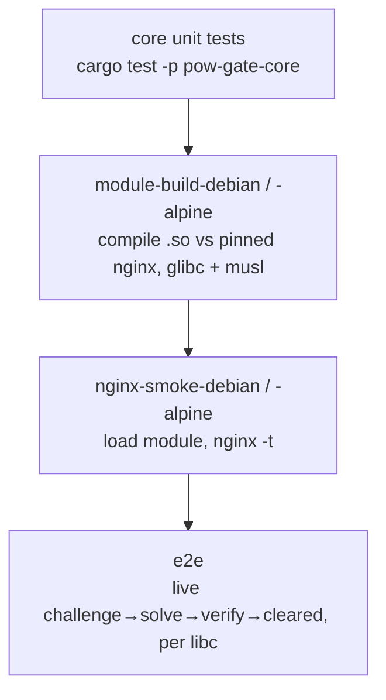

# Testing & self-verification

The project verifies both latest pinned mainline and stable nginx at three levels, each runnable on its own. The split
exists because the crypto can be tested anywhere, but the nginx module can only be
built and exercised against a real nginx — so that part runs in Docker.



- [Layout: where tests live](#layout-where-tests-live)
- [1. Core unit tests (no Docker)](#1-core-unit-tests-no-docker)
- [2. Module build (Docker)](#2-module-build-docker)
- [3. nginx smoke (Docker)](#3-nginx-smoke-docker)
- [4. End-to-end (Docker Compose)](#4-end-to-end-docker-compose)
- [One command](#one-command)
- [Manual testing (browser / curl)](#manual-testing-browser--curl)
- [CI](#ci)
- [What each layer proves](#what-each-layer-proves)

---

## Layout: where tests live

All code lives under a crate's `src/`: the nginx module in
`src/ngx-http-pow-gate/src/`, the engine in `src/pow-gate-core/src/`.
**Tests are their own projects**, never mixed into the source files:

```text
src/pow-gate-core/tests/         integration tests for the engine — one crate per file
                    (target, codec, pow, clearance, proof, ranges), public API only
tests/integration/  the black-box e2e client — a standalone Cargo project that
                    is NOT a workspace member (no nginx dependency)
docker/             Dockerfile (multi-stage pipeline) + nginx.test.conf
docker-compose.test.yml   wires nginx + the e2e client together
scripts/test.sh     runs the whole thing locally
```

---

## 1. Core unit tests (no Docker)

The engine — PoW target math, the challenge handshake, clearance tokens, and the
ECDSA proof — defaults to a pure Rust crate (`src/pow-gate-core/`) with no nginx
dependency, so it runs on any machine in well under a second:

```bash
cd src/pow-gate-core && cargo test
# or from the repo root:
cargo test -p pow-gate-core
```

These tests pin the wire contract the browser must reproduce (the PoW hash, the
`difficulty → target` math) and prove the security properties: forged/expired/
tampered tokens are rejected, a client can't downgrade difficulty, and stale or
mismatched proofs fail.

---

## 2. Module build (Docker)

Compiles the dynamic module `.so` against a pinned nginx source. This is the step
you can't do without a matching nginx — it proves the FFI shell compiles and is
ABI-bound to that nginx. A dynamic module is libc-specific, so there is one stage
per target:

```bash
docker build -f docker/Dockerfile --target module-build-debian .   # glibc (Debian trixie)
docker build -f docker/Dockerfile --target module-build-alpine .   # musl  (Alpine)
```

Pin `NGINX_VERSION` (build arg) to the nginx you deploy; `--with-compat` gives a
stable module ABI (see [build.md](build.md)).

---

## 3. nginx smoke (Docker)

Loads the freshly built `.so` into the matching `nginx:<version>` image (Debian
or Alpine) and runs `nginx -t` against
[docker/nginx.test.conf](../docker/nginx.test.conf), which exercises **every**
directive. It fails if the module is ABI-incompatible or any directive won't
parse:

```bash
docker build -f docker/Dockerfile --target nginx-smoke-debian .   # glibc
docker build -f docker/Dockerfile --target nginx-smoke-alpine .   # musl
```

---

## 4. End-to-end (Docker Compose)

Brings up nginx with the module, then runs the black-box client
([tests/integration](../tests/integration)) which walks the full handshake —
fetch a challenge, **solve it with `pow-gate-core`**, submit, then make a cleared
request with a **`p256`-signed proof** (the same primitives the browser uses):

```bash
docker compose -f docker-compose.test.yml up --build \
  --abort-on-container-exit --exit-code-from e2e
```

Exit code is the client's, so it gates CI. The client asserts: excluded paths are
never gated, an uncleared request is challenged, `/verify` sets a clearance
cookie, a cleared request reaches the upstream, and a challenged `POST` (and
`PUT`) comes back inside the challenge page verbatim (`pow_gate_replay`) — with
`replay off` and an oversized body falling back to the plain page, and
`client_max_body_size` still rejecting ahead of the gate.

---

## One command

```bash
./scripts/test.sh          # core tests + full Docker pipeline
./scripts/test.sh core     # just the engine tests (fast)
./scripts/test.sh docker   # build + smoke + e2e
```

---

## Manual testing (browser / curl)

The automated e2e proves the protocol; the manual sandbox is for everything a
human notices — the challenge page rendering, solver progress, cookie behaviour
across reloads, a custom `pow_gate_page`. It publishes nginx + the module on
`http://localhost:12222` (an unassuming port, so it does not collide with the
usual 8080 tenants):

```bash
./scripts/dev.sh up       # build + start, prints what to try (default when run bare)
./scripts/dev.sh check    # smoke checks + full node handshake; exits 1 on any failure
./scripts/dev.sh reload   # nginx -t, then apply an edited docker/nginx.dev.conf (no rebuild)
./scripts/dev.sh logs     # follow nginx logs
./scripts/dev.sh down     # stop + remove, including volumes
```

The script needs `docker compose` and can be run from anywhere (it cd's to the
repo root itself). `check` needs node ≥ 20 for the handshake part; without node
it still runs the curl smoke checks and just skips the automated solve.

Open `http://localhost:12222/` in a browser: you get the challenge page, the
solver runs (a browser hashes far slower than native, so this
still shows the progress bar for a few seconds), and after
verification a reload serves the stubbed upstream page via the clearance
cookie. That page ([docker/www/index.html](../docker/www/index.html)) renders
the **computation result** of the solve — winning nonce, hashes tried, solve
time, hash rate, salt and the recomputed winning hash (leading zeros
highlighted) — from the `pow-result` record the solver leaves in
`sessionStorage`. Recording is **opt-in** (off by default, production never
records): pages opt in with `data-record-result` on the solver `<script>` tag.
The dev sandbox serves a generated copy of the embedded page with that
attribute added (`scripts/dev.sh` builds `docker/challenge.dev.html`, served
via `pow_gate_page` — which doubles as live coverage for that directive).
That page also carries the **POST replay** test — the one part of the flow no
headless client can exercise, because it runs in `solver.js`. Click *“Drop
clearance, then POST”*: the sandbox expires the cookie server-side (it is
HttpOnly), the form submits, the gate answers that POST with the challenge page,
and after the solve the solver re-issues the submission — you land on
**POST received** ([docker/www/posted.html](../docker/www/posted.html)) instead
of losing it. Open the Network tab to confirm the replayed request carries the
original payload. Without the drop, the same button set just POSTs while cleared
and goes straight there.

Useful curl checks (also printed by `dev.sh up`):

| Request | Expected |
| --- | --- |
| `curl -i localhost:12222/` | challenge HTML — no clearance |
| `curl localhost:12222/healthz` | `ok` — excluded path, never gated |
| `curl -A verifierbot localhost:12222/` | upstream content — verified good bot |
| `curl -iA denybot localhost:12222/` | denied |

`./scripts/dev.sh check` runs the same checks headlessly: curl smoke checks
(challenge served, endpoints up, excluded path, verifier allow, deny) plus the
full handshake via [tests/pow-clearance/solve-test.mjs](../tests/pow-clearance/solve-test.mjs) — a
node port of `assets/solver.js` that solves the PoW, posts `/verify`, replays
the clearance cookie as a top-level navigation and expects the upstream
marker. It needs only node ≥ 20, no cargo.

Unlike `nginx.test.conf` (baked into the image), [docker/nginx.dev.conf](../docker/nginx.dev.conf)
is **volume-mounted**: tweak difficulty, cookies, decisions, or point
`pow_gate_page` at a mounted custom page (see the commented lines there and in
[docker-compose.dev.yml](../docker-compose.dev.yml)), then `./scripts/dev.sh reload`.
Only module code changes need a rebuild (`./scripts/dev.sh up`). Knobs:
`DEV_PORT=9090` for another host port, `DEV_TARGET=nginx-smoke-alpine` for the
musl build.

---

## CI

CI is split across a few workflows:

- [ci.yml](../.github/workflows/ci.yml) — a fast `core` job (engine tests + e2e
  client compiles) and an `e2e` job (the live handshake) as a **matrix of
  `{nginx channel × libc × arch}`** (`debian`→glibc, `alpine`→musl, on `amd64` and `arm64`).
- [module-amd64.yml](../.github/workflows/module-amd64.yml) /
  [module-arm64.yml](../.github/workflows/module-arm64.yml) — build the `.so` +
  `nginx -t` for both libc on each architecture. Split per arch so each carries
  its own status badge (native arm runners, no QEMU; digest-pinned multi-arch
  base images resolve to the runner's arch).
- [release.yml](../.github/workflows/release.yml) — on a tag: reproducible double
  build + provenance + cosign + checksums for all four `{nginx channel × libc × arch}` `.so`s; see
  [build.md](build.md#verifiable-builds).

---

## What each layer proves

| Layer        | Proves                                                              | Needs   |
| ------------ | ------------------------------------------------------------------ | ------- |
| core tests   | the crypto/protocol is correct and the wire contract is pinned     | Rust    |
| module-build-{debian,alpine} | the FFI shell compiles + is ABI-bound to nginx, on glibc and musl | Docker  |
| nginx-smoke-{debian,alpine}  | the module loads and every directive parses, on both libc          | Docker  |
| e2e          | the live request flow works end to end against real nginx (per libc) | Docker  |

The 2026-10-18 performance pass passed 73 portable and 74 native-crypto core
tests, two updater regression tests, and native glibc/amd64 builds and live
suites on nginx 1.31.7 and 1.30.6. All eight Docker end-to-end cells passed across
both nginx channels, Debian/glibc and Alpine/musl, and amd64/arm64. Failed-reload
Docker targets passed on both channels and architectures. Local ARM64 execution
uses QEMU for correctness checks. Performance tests run only on Linux/amd64.

The HTTP/3 follow-up also passed on both versions with four workers, using native
glibc/amd64 HTTP/3-enabled nginx. Both the existing distributable modules and
fresh modules built against the HTTP/3-enabled source trees passed. HTTP/1.1 and
HTTP/2 regression suites passed on the expanded TLS/QUIC fixture as well.

## Protocol-v2 security and memory checks

Core tests cover key/client/policy binding, address-prefix boundaries, IPv4-mapped
IPv6, assurance downgrade, legacy-token rejection, TTL reduction, key-possession
signatures, expiry, ledger saturation and live-entry retention. The fixed table
fits the 2 MiB zone. The live fixture runs four nginx workers and races 16
redemptions, asserting exactly one 204 and fifteen 409s; it also checks cookie UA
binding and no-JS grant reuse.

`tests/pow-clearance/security-test.mjs` additionally tests genuine source-address
changes (when `POW_TEST_SECOND_IP=127.0.0.2` on a loopback fixture), different named
policies, higher required difficulty, another valid nonce for a spent challenge,
method restrictions, the 8 KiB verify body cap and graceful reload preservation.
The isolated fixture needs `/other-policy` and `/stronger` locations that serve
the upstream marker but override policy name / difficulty. Only set
`NGINX_PID_FILE` to that isolated fixture's PID file: the test sends SIGHUP to it.

`http2-test.mjs` runs the redemption race over multiplexed HTTP/2 streams and
tests unknown-length DATA at exactly 8 KiB and 8 KiB + 1. Both Node suites run
after the Rust client in Docker e2e. `reload-test.py` starts its own unprivileged
nginx and checks early/late failed reloads, worker respawn, pending no-JS grants,
one-use state, and successful policy reload. Run it directly with paths to the
matching native nginx and module, or use the `security-reload` Docker target.
The Debian module workflows run this target on both versions and architectures.

`http3-test.py` uses the pinned aioquic client over TLS/QUIC, with only `h3` in
ALPN and no TCP fallback. It verifies the fixture's `X-Pow-Test-HTTP3: h3` marker
on every response. Tests cover 16 concurrent streams on one connection, another
16-connection race that must reach multiple nginx workers, invalid signatures,
UA/address/policy/difficulty binding, nonce reuse, cookie navigation, required
request proofs, and no-JS grant reuse. The streamed body test accepts exactly
8,192 bytes and requires 413 for 8,193 bytes before the client sends FIN; the
rejected request must not consume the legitimate challenge.

The Docker fixture listens on UDP 8443 with a generated test certificate; the
client trusts that certificate explicitly and validates the hostname. The TLS
certificate and protocol/worker response headers are test-only. Both Debian and
Alpine smoke images include this listener, and Docker e2e always runs HTTP/3
after the HTTP/1.1 and HTTP/2 suites, for both nginx channels and architectures.
The official runtime images must include nginx's HTTP/3 module.

To run against an already started isolated fixture:

```bash
python3 -m venv .nginx/http3-venv
.nginx/http3-venv/bin/pip install -r tests/pow-clearance/http3-requirements.txt
.nginx/http3-venv/bin/python tests/pow-clearance/http3-test.py \
  https://localhost:8443 --ca-file /path/to/test-tls/cert.pem
```

For native testing, configure nginx with `--with-compat --with-http_ssl_module
--with-http_realip_module --with-http_v2_module --with-http_v3_module`, then build
the matching module. The fixture's `/other-policy`, `/stronger`, trusted test-IP
header, four workers, and protocol/worker response headers are required.
See the [nginx HTTP/3 module](https://nginx.org/en/docs/http/ngx_http_v3_module.html)
and [aioquic API](https://aioquic.readthedocs.io/en/latest/asyncio.html) documentation.
This suite does not exercise 0-RTT, live address migration or UDP-loss behavior.

CI builds/tests `{mainline, stable} x {glibc, musl} x {amd64, arm64}`. All source
hashes/runtime image digests live in `docker/nginx-versions.json`. Use:

```bash
./scripts/build-nginx.sh mainline --target nginx-smoke-debian
./scripts/build-nginx.sh stable --target nginx-smoke-alpine
./scripts/test.sh docker  # both channels and both libcs, including live e2e
```

The daily updater checks the newest odd-minor mainline and even-minor stable
release independently, and retains the previous channel pin until both runtime
images exist. Release artifacts include the exact nginx version in their names.

## 0.5.0 resilience and cluster regressions

With a configured native nginx tree and matching module build:

```sh
export POW_NGINX="$PWD/.nginx/nginx-1.31.7/objs/nginx"
export POW_MODULE="$PWD/target/debug/libngx_http_pow_gate.so"
python3 tests/pow-clearance/native-test.py "$POW_NGINX" "$POW_MODULE"
python3 tests/pow-clearance/reload-test.py "$POW_NGINX" "$POW_MODULE"
python3 tests/pow-clearance/feeds-test.py "$POW_NGINX" "$POW_MODULE"
npm ci --ignore-scripts --prefix tests/browser
(cd tests/browser && npx playwright install chromium firefox)
npm test --prefix tests/browser
```

The browser suite starts an isolated nginx and uses real WebCrypto and workers.
It tests normal clearance, worker-blocking CSP, transient reset/429, lost verify
responses after server commit, failed initial script loads, unavailable IndexedDB,
silent workers, old cookie names, cookie refusal and concurrent tabs. Both
Chromium and Firefox are covered. `POW_BROWSERS=chromium` narrows the run; optional
`POW_CHROMIUM` / `POW_FIREFOX` select executable paths. Browser/module copies are
isolated so rebuilding the module cannot overwrite a mapped test binary.

The feed suite runs two providers with independent failure/expiry and rejects
zero/invalid/overflowing refresh times. The native suite runs the existing
security, HTTP/2 streaming-body and handshake tests against the default local
ledger; the reload suite checks configuration-cycle lifetime after failed reloads.

For Redis, first start a **dedicated disposable** primary:

```sh
docker run -d --name pow-gate-test-redis -p 127.0.0.1:16379:6379 redis:8-alpine \
  redis-server --maxmemory 16mb --maxmemory-policy noeviction --save '' --appendonly no
node tests/pow-clearance/cluster-test.mjs
docker rm -f pow-gate-test-redis
```

`POW_REDIS` selects a numeric host:port (default `127.0.0.1:16379`). This suite
changes global Redis memory configuration and deliberately pauses the primary;
never point it at a shared/deployed service. It creates random test namespaces,
cleans its own keys, and uses isolated nginx masters. It includes the existing
security and HTTP/2 suites plus cross-node redemption races, no-JS, restart/reload,
ACL authentication, OOM, clock high-water, queue/deadline limits, client aborts,
namespace separation, epoch rotation and missing-state fencing.

CI runs these native/browser/Redis suites on both pinned nginx channels, in
addition to the existing libc/architecture build/e2e matrix. The standalone
[PoW experiment](../experiments/pow/README.md) is a manual benchmark, outside the
production dependency graph.


Local v0.5.0 validation (2026-10-18) passed Chromium/Firefox recovery suites,
native HTTP/1.1 and HTTP/2 security suites, failed-reload, feed and gzip tests,
and the real Redis cross-node/failure suite on nginx 1.31.7 and 1.30.6 (glibc,
amd64). Redis compatibility checks also passed against the retained pre-performance
module in both issuance directions. Real TLS/QUIC HTTP/3 suites passed on both
versions with local and Redis backends, including early streaming-body rejection.
The complete libc/architecture Docker matrix passed as described above.

For the HTTP/3 fixtures, build nginx with `--with-http_ssl_module
--with-http_v3_module`, install `tests/pow-clearance/http3-requirements.txt` in a
venv, and invoke `tests/pow-clearance/transport-test.py <nginx> <module>` from that
venv. Set `POW_REDIS=127.0.0.1:16379` to run both backends. The script creates its
own TLS certificate, ports, prefix and module copy.

The module enables the core's `native-crypto` feature for ring's HMAC and P-256 routines.
Run both implementations when changing authentication:

```bash
cargo test --locked -p pow-gate-core
cargo test --locked -p pow-gate-core --features native-crypto
```

Compatibility tests compare the accelerated verifier against RustCrypto using
valid, mutated, malformed, high-S/low-S signatures and compressed/uncompressed
keys. They also check prepared HMAC framing against an independent HMAC and
scope serialization against the existing JSON tuple representation.

Docker module and end-to-end client builds retain Cargo caches per architecture
(and, for modules, per libc). The exported module/client binary is copied outside
the cache mount. Source crate roots are touched before compilation so older
copied timestamps cannot hide changed code. `--build-arg CARGO_BUILD_JOBS=2`
optionally bounds local build parallelism; leaving it unset preserves Cargo's
default. BuildKit caches can be pruned without changing build correctness.

## Allocation follow-up, 2026-10-18

The allocation follow-up passes 78 portable and 79 native-crypto core tests.
`clearance_fast.rs` compares against the original verifier, including signed
malformed/escaped JSON, duplicate fields, extreme timestamps, exact 4 KiB tokens
and normal-token allocation counts (six reduced to one). The gzip fixture now
checks repeated shared-body reads, HTML/JavaScript compression, HEAD and a slow
reader of a 736 KiB rendered custom page.

Both pinned nginx channels pass native wire, reload, feed, gzip, Chromium/Firefox,
Redis previous/current compatibility and real TLS/QUIC HTTP/3 suites. All four
Linux/amd64 Docker glibc/musl end-to-end cells and both failed-reload targets pass.
ARM64 results elsewhere in this document describe the earlier performance pass.
All performance measurements are Linux/amd64 only; the follow-up benchmark adds
physical-core separation, client/server CPU accounting and concurrency sweeps.
